# pr-review-agent

[](https://github.com/Vijay021212/pr-review-agent/actions/workflows/ci.yml)
[](LICENSE)

An AI agent that reviews GitHub pull requests the way a careful senior engineer would: it understands the goal of the change, explores the related code on its own, finds real problems at five review levels, double-checks them, and posts one clear review with a recommendation. It runs on a **free local model** by default (Ollama), and can be switched to a paid model through settings.

> **Status:** in development. Reviews in the terminal and on GitHub work; measured scores come with v0.3.0. Progress is tracked in the [issues](https://github.com/Vijay021212/pr-review-agent/issues), [milestones](https://github.com/Vijay021212/pr-review-agent/milestones) and [project board](https://github.com/users/Vijay021212/projects/2).

## Requirements

- Windows or Linux, Python 3.12 or newer, and [uv](https://docs.astral.sh/uv/)
- [Ollama](https://ollama.com/) with `qwen2.5-coder:7b` (a 4.7 GB download), or an API key for a paid provider
- A GitHub token with **Contents: read** and **Pull requests: write**

## Install

```powershell
git clone https://github.com/Vijay021212/pr-review-agent
cd pr-review-agent
uv sync
ollama pull qwen2.5-coder:7b
```

## Usage

```powershell
uv run pr-review-agent review https://github.com/owner/repo/pull/7            # review and post
uv run pr-review-agent review https://github.com/owner/repo/pull/7 --dry-run  # show only, post nothing
```

The review is printed in the terminal: what the agent understood the pull request is for, the recommendation and the rule that decided it, every finding with its line, and what was reviewed or skipped. Progress messages go to the error stream, so `> review.md` saves the review alone.

Without `--dry-run`, the findings are posted as comments on their lines, all in one review of type "comment", and the summary is posted as a comment, or updated if an earlier one is there. The agent never approves or blocks a pull request: the recommendation is informational, and a person decides. Nothing is posted if the pull request gets a new commit during the review. Posting needs a GitHub token with **Contents: read** and **Pull requests: write**.

Exit codes: `0` the review is complete; `1` the review is incomplete; `2` bad input or a setup problem, with a message saying how to fix it.

From Python:

```python
from pr_review_agent import review_pull_request

result = review_pull_request("https://github.com/owner/repo/pull/7", dry_run=True)
print(result.recommendation.value, len(result.findings.kept))
```

## Settings

Settings come from environment variables or a `.env` file in the folder you run the command from.

| Setting | Default |
|---|---|
| `PRRA_PROVIDER` | `ollama` |
| `PRRA_MODEL` | `qwen2.5-coder:7b` |
| `PRRA_ENDPOINT` | `http://localhost:11434` |
| `PRRA_GITHUB_TOKEN` | falls back to `GITHUB_TOKEN`; optional for public repositories |
| `PRRA_CONTEXT_TOKENS` | `16384` |
| `PRRA_TIME_LIMIT_MINUTES` | `20` |

The full list is in [design section 10](docs/design.md#10-settings).

## How it works

One agent works through fixed stages; the model is used only where judgement is needed, and every decision that must be predictable is plain code.

```mermaid
flowchart LR
    preflight["0. Preflight<br/>token, model, lock"] --> fetch["1. Fetch<br/>the pull request"]
    fetch --> select["2. Select files<br/>skip, rank, batch"]
    select --> understand["3. Understand<br/>goal and risks"]
    understand --> explore["4. Explore<br/>read related code"]
    explore --> find["5. Find problems<br/>bugs; security and performance"]
    find --> check["6. Double-check<br/>anchor, re-check, de-duplicate"]
    check --> recommend["7. Recommend<br/>fixed rules"]
    recommend --> publish["8. Publish<br/>one review + summary"]
```



| Stage | What happens | Uses the model? |
|---|---|---|
| 0. Preflight | Checks Ollama, the model and the GitHub token; one review of a pull request at a time | No |
| 1. Fetch | Reads the pull request at its latest commit; refuses closed and merged ones | No |
| 2. Select files | Skips lock, binary and generated files with a reason; fits the rest into the model's context | No |
| 3. Understand | Writes down the goal, a summary and the risky parts | Yes |
| 4. Explore | Downloads the code at that commit and reads related code with read-only tools: search, open a file, list a folder | Yes, step by step |
| 5. Find problems | Pass A: correctness and regressions (levels 1–3). Pass B: security and performance (levels 4–5) | Yes |
| 6. Double-check | Puts every finding on a changed line, re-checks it against the code, removes duplicates | Yes |
| 7. Recommend | Approve, Request Changes or Needs Human Review, by fixed rules, with the rule that decided it | No |
| 8. Publish | Posts all findings in one plain comment review and the summary, unless it's a dry run | No |

Pull request text and code are always treated as data, never as instructions; the tools can only read inside the downloaded code; secrets are masked in everything the agent writes. The full design is in [docs/design.md](docs/design.md).

## Evaluation

```powershell
uv run pr-review-agent eval eval/cases --runs 3
```

Reviews every test pull request in `eval/cases` with the real agent, offline (nothing is read from or posted to GitHub), and writes `report.md`, `review-sheet.md` and `results.json` to `eval/results/<date-time>/`. Each case is a folder with a `case.yaml` (title, description, the planted problems and the expected recommendation), a `base/` and a `head/` folder: the code before and after the change. The report gives every measure of [requirements section 7](docs/requirements.md#7-how-we-measure-success) per review level, for the held-out cases separately, as the average, lowest and highest over the runs. The review sheet lists every finding with its explanation for a person to confirm.

The cases in `eval/cases` are 33 small pull requests: 25 with one planted problem each (5 per review level, from a missing None check to a race on a wallet balance), 5 clean changes where any comment is a false alarm, and 3 prompt-injection attempts. 12 of them, spread over every kind and level, are held out: they are never looked at while tuning prompts or settings, so their scores show how the agent does on changes it wasn't tuned on.

*Scores are published from v0.3.0.*

## Development

```powershell
uv sync                     # install the package and the development tools
uv run ruff check .         # lint
uv run ruff format .        # format
uv run mypy                 # type-check (strict)
uv run pytest               # tests, with the 90% coverage gate
```

Every change follows the [quality rule](docs/plan.md#3-quality-rule) and goes through a pull request with passing CI.

## Documentation

| Document | Contents |
|---|---|
| [Requirements](docs/requirements.md) | What the agent must do, and how success is measured |
| [Design](docs/design.md) | How it's built: stages, interfaces, GitHub and model integration |
| [Plan](docs/plan.md) | Releases, issues and the quality rule every change follows |
| Decision records | [ADR-001 default model](docs/adr/001-model-choice.md), [ADR-002 one agent in stages](docs/adr/002-single-agent-with-stages.md), [ADR-003 own model wrappers](docs/adr/003-own-model-wrappers.md) |
| [Model test](experiments/adr-001-model-test/) | The test behind ADR-001, with every raw answer |
| [Changelog](CHANGELOG.md) | Changes in each release |

## Licence

[MIT](LICENSE)
