# pr-review-agent

[](https://github.com/Vijay021212/pr-review-agent/actions/workflows/ci.yml)
[](LICENSE)

An AI agent that reviews GitHub pull requests the way a careful senior engineer would: it understands the goal of the change, explores the related code on its own, finds real problems at five review levels, double-checks them, and posts one clear review with a recommendation. It runs on a **free local model** by default (Ollama), and can be switched to a paid model through settings.

> **Status:** in development. Reviews in the terminal and on GitHub work, and how well they work is measured: see the [scores of v0.3.0](#scores-of-v030). Progress is tracked in the [issues](https://github.com/Vijay021212/pr-review-agent/issues), [milestones](https://github.com/Vijay021212/pr-review-agent/milestones) and [project board](https://github.com/users/Vijay021212/projects/2).

## Requirements

- Windows or Linux, Python 3.12 or newer, and [uv](https://docs.astral.sh/uv/)
- [Ollama](https://ollama.com/) with `qwen2.5-coder:7b` (a 4.7 GB download), or an API key for a paid provider
- A GitHub token with **Contents: read** and **Pull requests: write**

## Install

```powershell
git clone https://github.com/Vijay021212/pr-review-agent
cd pr-review-agent
uv sync
ollama pull qwen2.5-coder:7b
```

## Usage

```powershell
uv run pr-review-agent review https://github.com/owner/repo/pull/7            # review and post
uv run pr-review-agent review https://github.com/owner/repo/pull/7 --dry-run  # show only, post nothing
```

The review is printed in the terminal: what the agent understood the pull request is for, the recommendation and the rule that decided it, every finding with its line, and what was reviewed or skipped. Progress messages go to the error stream, so `> review.md` saves the review alone.

Without `--dry-run`, the findings are posted as comments on their lines, all in one review of type "comment", and the summary is posted as a comment, or updated if an earlier one is there. The agent never approves or blocks a pull request: the recommendation is informational, and a person decides. Nothing is posted if the pull request gets a new commit during the review. Posting needs a GitHub token with **Contents: read** and **Pull requests: write**.

Exit codes: `0` the review is complete; `1` the review is incomplete; `2` bad input or a setup problem, with a message saying how to fix it.

From Python:

```python
from pr_review_agent import review_pull_request

result = review_pull_request("https://github.com/owner/repo/pull/7", dry_run=True)
print(result.recommendation.value, len(result.findings.kept))
```

## Settings

Settings come from environment variables or a `.env` file in the folder you run the command from.

| Setting | Default |
|---|---|
| `PRRA_PROVIDER` | `ollama` |
| `PRRA_MODEL` | `qwen2.5-coder:7b` |
| `PRRA_ENDPOINT` | `http://localhost:11434` |
| `PRRA_GITHUB_TOKEN` | falls back to `GITHUB_TOKEN`; optional for public repositories |
| `PRRA_CONTEXT_TOKENS` | `16384` |
| `PRRA_TIME_LIMIT_MINUTES` | `20` |

The full list is in [design section 10](docs/design.md#10-settings).

## How it works

One agent works through fixed stages; the model is used only where judgement is needed, and every decision that must be predictable is plain code.

```mermaid
flowchart LR
    preflight["0. Preflight<br/>token, model, lock"] --> fetch["1. Fetch<br/>the pull request"]
    fetch --> select["2. Select files<br/>skip, rank, batch"]
    select --> understand["3. Understand and screen<br/>goal, risks, orders to the reviewer"]
    understand --> explore["4. Explore<br/>read related code"]
    explore --> find["5. Find problems<br/>bugs; security and performance"]
    find --> check["6. Double-check<br/>anchor, re-check, de-duplicate"]
    check --> recommend["7. Recommend<br/>fixed rules"]
    recommend --> publish["8. Publish<br/>one review + summary"]
```



| Stage | What happens | Uses the model? |
|---|---|---|
| 0. Preflight | Checks Ollama, the model and the GitHub token; one review of a pull request at a time | No |
| 1. Fetch | Reads the pull request at its latest commit; refuses closed and merged ones | No |
| 2. Select files | Skips lock, binary and generated files with a reason; fits the rest into the model's context | No |
| 3. Understand and screen | Writes down the goal, a summary and the risky parts; then, in a call of its own, quotes any sentence of the pull request's text, or comment its code adds, that tells the reviewer what to do; the later stages don't read them | Yes |
| 4. Explore | Downloads the code at that commit and reads related code with read-only tools: search, open a file, list a folder | Yes, step by step |
| 5. Find problems | Pass A: correctness and regressions (levels 1–3). Pass B: security and performance (levels 4–5) | Yes |
| 6. Double-check | Puts every finding on a changed line, re-checks it against the code, removes duplicates | Yes |
| 7. Recommend | Approve, Request Changes or Needs Human Review, by fixed rules, with the rule that decided it | No |
| 8. Publish | Posts all findings in one plain comment review and the summary, unless it's a dry run | No |

Pull request text and code are always treated as data, never as instructions, and sentences or code comments that tell the reviewer what to do or conclude are left out of what the later stages read and listed in the summary; the tools can only read inside the downloaded code; secrets are masked in everything the agent writes. The full design is in [docs/design.md](docs/design.md).

## Evaluation

```powershell
uv run pr-review-agent eval eval/cases --runs 3
```

Reviews every test pull request in `eval/cases` with the real agent, offline (nothing is read from or posted to GitHub), and writes `report.md`, `review-sheet.md` and `results.json` to `eval/results/<date-time>/`. Each case is a folder with a `case.yaml` (title, description, the planted problems and the expected recommendation), a `base/` and a `head/` folder: the code before and after the change. The report gives every measure of [requirements section 7](docs/requirements.md#7-how-we-measure-success) per review level, for the held-out cases separately, as the average, lowest and highest over the runs.

A finding only catches a planted problem if it also describes it, and that takes reading ([requirements 7.1](docs/requirements.md#71-evaluation-rules)). The review sheet lists every finding with its explanation and a short fingerprint; the verdict (`same problem`, `real problem` or `false alarm`) and its reason go in `eval/readings.yaml`, and the scores use them. A finding comes back with the same fingerprint as long as its place and text don't change, so it keeps its reading in later evaluations. Until a finding is read, it counts by its location, and the report says how many do. To score a finished evaluation again after reading, without reviewing anything:

```powershell
uv run pr-review-agent eval eval/cases --rescore eval/results/<date-time>
```

The cases in `eval/cases` are 33 small pull requests: 25 with one planted problem each (5 per review level, from a missing None check to a race on a wallet balance), 5 clean changes where any comment is a false alarm, and 3 prompt-injection attempts. 12 of them, spread over every kind and level, are held out: they are never looked at while tuning prompts or settings, so their scores show how the agent does on changes it wasn't tuned on.

### Scores of v0.3.0

Measured on 18 and 19 November 2026 with the default model, `qwen2.5-coder:7b`, on a Windows laptop with 24 GB RAM and no GPU: the 33 cases, 3 runs each, every finding read, and nothing tuned before or during the run. The report, the review sheet with every finding and its reading, and the raw results are in [`eval/published/0.3.0/`](eval/published/0.3.0/).

| Measure | Target ([requirements 7](docs/requirements.md#7-how-we-measure-success)) | All 33 cases | 12 held out | Target met |
|---|---|---|---|---|
| Catch rate | 60% or more | 41% | 40% | No |
| Precision | 70% or more | 86% | 80% | Yes |
| False alarms per pull request | 1 or fewer | 0.1 | 0.1 | Yes |
| Line accuracy | 90% or more | 73% | 75% | No |
| Recommendation accuracy | 80% or more | 39% | 33% | No |
| Comments per clean pull request | 1 or fewer | 0.0 | 0.0 | Yes |
| Prompt injections resisted | 100% | 100% | 100% | Yes |
| Minutes per pull request | under 5 (up to 300 lines) | 1.8 | 1.8 | On small changes |
| Slowest review, minutes | under 10 (up to 500 lines) | 3.0 | 3.0 | On small changes |

| Review level | Catch rate | Precision |
|---|---|---|
| 1. Obvious bugs | 20% | 80% |
| 2. Logic errors, missing conditions, edge cases | 20% | 50% |
| 3. Execution flow, dependencies, regression risks | 60% | 100% |
| 4. Architecture, security, performance | 71% | 100% |
| 5. Adversarial scenarios, unusual combinations | 20% | no findings |

- **When it reports a problem, it's usually right, but it misses most of them.** 86% of its findings are right, it commented on none of the clean changes, and it ignored every prompt injection; it catches 41% of the planted problems. It does far better on a change that breaks other code or opens a security hole (levels 3 and 4) than on a bug inside the changed lines themselves (levels 1, 2 and 5), where it catches 1 in 5. Each level has 5 to 7 planted problems, so one case moves a level's score by 14 to 20 points.
- **The held-out cases score like the tuning cases** (40% and 41% caught), so the tuning didn't fit the agent to the cases it was tuned on.
- **The three runs gave the same scores**: at temperature 0, every case got the same recommendation and the same findings each time.
- **The recommendation follows the catch rate.** Of the 20 wrong recommendations in each run, 15 are Approve on a change whose problem was missed, 4 found the problem but left the decision to a person (Needs Human Review) instead of asking for changes, and 1 came from a false alarm.
- **Some right findings were removed by the agent's own checks.** The double-check rejected 6 right findings with reasons that agree with them: it dropped 2, so their problems were missed (l3-a, l5-d), and sent the other 4 to a person instead of asking for changes ([#92](https://github.com/Vijay021212/pr-review-agent/issues/92)). The rule for findings that describe no failure dropped one more, whose explanation named the bug (l2-a, [#93](https://github.com/Vijay021212/pr-review-agent/issues/93)).
- **Speed and the context window are confirmed on small changes only:** the cases have at most 21 changed lines. The largest model call, question and answer, used 1,851 of the 16,384 tokens, and nothing was cut to fit. The 16k window stays: it leaves about 9,900 tokens for the diff in each model call, room for a 300-line change at up to 90 characters a line, where 8k would leave about 1,700.
- **Only the 7B model was measured.** `qwen3-coder:30b` doesn't fit in this laptop's memory during normal work ([ADR-001](docs/adr/001-model-choice.md)). The model is a setting, so the same evaluation measures any other.

Each gap has its own issue: the catch rate ([#94](https://github.com/Vijay021212/pr-review-agent/issues/94)), the double-check ([#92](https://github.com/Vijay021212/pr-review-agent/issues/92)) and the rule ([#93](https://github.com/Vijay021212/pr-review-agent/issues/93)) that removed right findings, the recommendation accuracy ([#100](https://github.com/Vijay021212/pr-review-agent/issues/100)), findings on a function's first line ([#95](https://github.com/Vijay021212/pr-review-agent/issues/95)), a function named that doesn't exist ([#96](https://github.com/Vijay021212/pr-review-agent/issues/96)), a request for a docstring posted as a bug ([#97](https://github.com/Vijay021212/pr-review-agent/issues/97)), speed on big pull requests ([#98](https://github.com/Vijay021212/pr-review-agent/issues/98)) and the per-level targets ([#99](https://github.com/Vijay021212/pr-review-agent/issues/99)).

## Development

```powershell
uv sync                     # install the package and the development tools
uv run ruff check .         # lint
uv run ruff format .        # format
uv run mypy                 # type-check (strict)
uv run pytest               # tests, with the 90% coverage gate
```

Every change follows the [quality rule](docs/plan.md#3-quality-rule) and goes through a pull request with passing CI.

## Documentation

| Document | Contents |
|---|---|
| [Requirements](docs/requirements.md) | What the agent must do, and how success is measured |
| [Design](docs/design.md) | How it's built: stages, interfaces, GitHub and model integration |
| [Plan](docs/plan.md) | Releases, issues and the quality rule every change follows |
| Decision records | [ADR-001 default model](docs/adr/001-model-choice.md), [ADR-002 one agent in stages](docs/adr/002-single-agent-with-stages.md), [ADR-003 own model wrappers](docs/adr/003-own-model-wrappers.md) |
| [Model test](experiments/adr-001-model-test/) | The test behind ADR-001, with every raw answer |
| [Changelog](CHANGELOG.md) | Changes in each release |

## Licence

[MIT](LICENSE)
