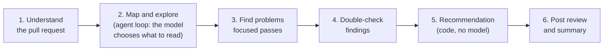

# ADR-002: One agent working in clear stages

- **Status:** Accepted, 2026-11-05
- **Decided by:** Vijay Bolle
- **Requirements:** FR-2, FR-5, FR-6 to FR-10, FR-12, NFR-2, NFR-3, NFR-4

## Context

The review has several jobs: understand the pull request, explore related code, find problems at five review levels and in five categories, double-check the findings, decide a recommendation, and post. The question is how to organise the model's work: in one call, as one agent working in stages, or as a team of specialist agents.

The constraints that matter:

- **One local model at a time.** The laptop holds one model in memory (ADR-001: `qwen2.5-coder:7b`), so specialist agents would run one after another, not side by side.
- **About 12 seconds per small model call** on the CPU (ADR-001 test), against a target of under 5 minutes for 300 changed lines (NFR-3).
- **Small models do better on narrow tasks** than on "do everything at once".

**What the jobs need from each other:**

| Job | Needs | Can run independently of the others? |
|---|---|---|
| Understand the pull request (FR-2) | The pull request | No: everything after it uses its result |
| Project map and exploration (FR-5) | The pull request and its understanding | No: the finding passes use what it found |
| Find problems, by focus | The explored context | **Yes**: the passes don't need each other |
| Double-check findings (FR-10) | The findings and the code | No: needs every pass's findings |
| Recommendation (FR-12) | The checked findings and the coverage | No model needed: fixed rules in code |
| Post (FR-13, FR-14) | Everything above | No model needed |

## Options

| Option | How it works | Model calls for a small pull request | Rough time on the laptop |
|---|---|---|---|
| A. One big prompt | One call that does everything, like PR-Agent | 1 | ~15 s |
| **B. One agent in stages** | Code runs fixed stages; the model does one focused job per stage, and decides for itself what to explore | 6–8 | 1–3 min |
| C. Multi-agent team | An orchestrator, a specialist agent per area, and an aggregator | 7 specialists × several steps each | 10+ min |

## Decision

**Option B: one agent working in clear stages.**

- **Code controls the order of the stages.** The model never decides to skip a stage, and the safety-critical steps (the recommendation, posting, the secret masking) are plain code.
- **The explore stage is a real agent loop:** the model chooses which files to open, what to search and when it has seen enough, within the step limit (FR-5).
- **The finding stage runs focused passes** that share the explored context, so related files are read once. The first build has one pass for correctness and regressions (levels 1 to 3) and one for security and performance (level 4 and selected level 5). Design fit and code quality (FR-7, FR-8) are added as a third pass in a later release.

## Why

- It keeps the main benefit of specialists, a narrow focus for each job, without each specialist exploring the code again on its own.
- It fits the speed target on a CPU, where option C very likely wouldn't.
- Each stage can be tested on its own with a fake model (NFR-8).
- Option A can't explore related code, which level 3 problems need.

## Consequences

- The stages need clear inputs and outputs, so that one can be swapped or upgraded without touching the others. This shapes the design document.
- Every stage's model calls, timings and results go in the run log (FR-23), so the evaluation can show which stage helps and which wastes time.
- If a stage fails, the review is incomplete (NFR-4); there's no partial recommendation.

## Revisit when

- **The evaluation shows a focused pass is weak** in a way a dedicated agent with its own exploration might fix. That pass alone can then be upgraded into a specialist agent.
- **A GPU or a paid model** makes several agents fast enough to fit the speed targets.
