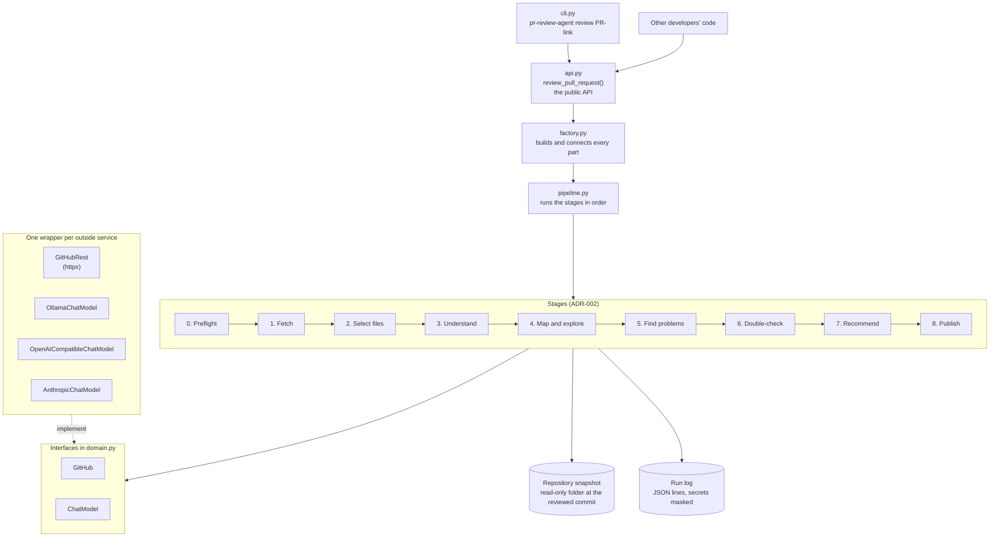
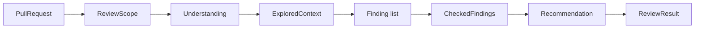

# Design

> **Status:** **v1.2.** v1.0 approved 2026-11-05 by Vijay Bolle; later changes go through change control (section 17).
> **Builds on:** [requirements v1.0](requirements.md), [ADR-001](adr/001-model-choice.md) (default model `qwen2.5-coder:7b`), [ADR-002](adr/002-single-agent-with-stages.md) (one agent working in stages), [ADR-003](adr/003-own-model-wrappers.md) (own model wrappers instead of LiteLLM).

The requirements say **what** the agent does. This document says **how** it's built: the parts of the program, what each part is responsible for, the data passed between them, and the important technical choices. Requirement IDs (FR-, NFR-) link each part back to why it exists.

---

## 1. The big picture



**The stages only know small interfaces**, never GitHub's API or a model provider directly. `factory.py` is the one place that picks the real implementations, and tests plug in fakes (NFR-8).

## 2. The stages

Code runs the stages in a fixed order (ADR-002). The model is used only in stages 3 to 6. Stage 4 is the one real agent loop.

| Stage | What it does | Uses the model? | Requirements |
|---|---|---|---|
| **0. Preflight** | Checks the settings, the GitHub token and its permissions, and that the model is reachable; takes the per-pull-request lock; starts the hard-limit clock | No | FR-16, FR-20 (lock), NFR-3 |
| **1. Fetch** | Reads the pull request: state, title, description, linked issue, head commit, changed files and their diffs. Refuses closed or merged pull requests. Downloads a **snapshot** of the repository at the head commit | No | FR-1, FR-19, FR-20, NFR-10 |
| **2. Select files** | Skips binary, lock and generated files and the rules file's ignore patterns; ranks the rest by importance; fits them into the model's budget; records every skip with its reason | No | FR-3, FR-4, FR-17 |
| **3. Understand** | Writes the goal, a plain summary of what changed, the risky parts and the "goal unclear" flag | Yes, one call | FR-2 |
| **4. Map and explore** | Builds the project map, then runs the **agent loop**: the model picks one read-only tool at a time until it has seen enough or reaches the step limit | Yes, one call per step | FR-5, NFR-5 |
| **5. Find problems** | Runs focused passes over the diff plus what stage 4 found. First release: pass A (correctness and regressions, levels 1–3) and pass B (security and performance, levels 4–5). Later: pass C (design fit and code quality) | Yes, one call per pass (per batch of files) | FR-6, FR-7, FR-8, FR-9 |
| **6. Double-check** | Re-checks each finding against the code, fixes or drops weak ones, anchors each on a changed line, removes duplicates of earlier runs, masks secrets | Yes, one call per batch of findings | FR-10, FR-11, FR-21 |
| **7. Recommend** | Applies the fixed rules: Approve, Request Changes or Needs Human Review, with the rule that decided it | **No: plain code** | FR-12, requirements 5.3 |
| **8. Publish** | Confirms the head commit hasn't changed, posts all findings in one review (type "comment"), then posts or updates the summary; with `--dry-run`, prints instead | No | FR-13, FR-14, FR-15, FR-19, FR-22 |

**Failure rule (NFR-4):** if any stage raises an error or the hard limit is reached, the pipeline stops, nothing more is posted, the terminal and run log say the review is **incomplete**, and the command exits with an error code.

### 2.1 The data passed between stages

Each stage takes plain, immutable data and returns new data. That's what lets every stage be tested alone.



| Type | Holds |
|---|---|
| `PullRequest` | owner, repo, number, state, draft flag, title, description, linked issue text, head commit SHA, head repository (for forks), base branch, changed files |
| `ChangedFile` | path, status (added, modified, removed, renamed), diff lines with old and new line numbers |
| `ReviewScope` | files to review, files skipped with a reason (`lock file`, `binary`, `ignored by rules`, `too large`), whether any changed file couldn't be reviewed |
| `Understanding` | goal, summary, risky parts, goal-unclear flag, whether the goal came from the description or was worked out from the code |
| `ExploredContext` | the project map, every tool call made, and the file excerpts the model chose to keep; whether the step limit was reached |
| `Finding` | file, line, side (new or removed code), category, review level, severity and its reason, status (`confirmed` or `potential risk`), trigger, current behaviour, expected behaviour, explanation, suggested fix, other affected places |
| `CheckedFindings` | findings kept, findings dropped with the reason, findings skipped as already posted or resolved |
| `Recommendation` | the value, the rule that decided it, and the reasons (e.g. which sensitive area matched) |
| `ReviewResult` | everything above, plus timings, the model and provider used, and the prompt version |

All of these are Pydantic models, so model output can be **validated** against the same types (FR-9).

## 3. Talking to GitHub

One wrapper, `GitHubRest`, behind a `GitHub` interface, using `httpx` and GitHub's REST API (plus one GraphQL query, below).

| Job | How | Requirement |
|---|---|---|
| Pull request details and head commit | `GET /repos/{owner}/{repo}/pulls/{number}` | FR-1, FR-19, FR-20 |
| Changed files and diffs | `GET .../pulls/{number}/files`, paged. GitHub leaves out the diff text for very large files; those become "too large" skips, never silent losses | FR-1, FR-4, NFR-10 |
| Repository snapshot | `GET /repos/{head owner}/{head repo}/tarball/{head sha}`, unpacked into a temporary folder with Python's safe `tarfile` "data" filter, which blocks paths that escape the folder | FR-5, FR-19, NFR-5 |
| Earlier comments by the agent | `GET .../pulls/{number}/comments`, looking for the agent's hidden fingerprint | FR-11 |
| Threads a person marked resolved | GraphQL `reviewThreads { isResolved }`, because the REST API doesn't show it | FR-11 |
| Post the findings | **One** `POST .../pulls/{number}/reviews` with `event: "COMMENT"`, `commit_id` set to the reviewed commit, and all inline comments, so it's all or nothing. The agent never sends `APPROVE` or `REQUEST_CHANGES` | FR-12, FR-13, FR-19 |
| Post or update the summary | A pull request comment carrying a hidden marker; on a re-run, the existing one is found and edited | FR-14, FR-22 |

**Hidden markers** are HTML comments that GitHub doesn't display, for example `<!-- pr-review-agent:summary -->` and `<!-- pr-review-agent:finding fp=3f9a2c -->`. A **fingerprint** is a short hash of the file, the category and the text of the anchored code line, so it survives line numbers shifting when other code changes.

**Temporary problems (NFR-10):** status 429 and 5xx responses and network errors are retried up to 4 times with a growing wait, honouring GitHub's `Retry-After`. After that the stage fails, which makes the review incomplete (NFR-4).

**Token:** a fine-grained token with **Contents: read** and **Pull requests: write**, read from `PRRA_GITHUB_TOKEN` or `GITHUB_TOKEN` (NFR-5).

## 4. Talking to models

A small `ChatModel` interface with one job: **send instructions and a message, get back JSON that matches a given schema.**

```python
class ChatModel(Protocol):
    def complete_json(self, system: str, user: str, schema: dict, deadline: Deadline) -> ModelReply: ...
```

| Wrapper | Talks to | How it gets JSON |
|---|---|---|
| `OllamaChatModel` (default) | Ollama on this computer, `/api/chat` | Ollama's `format` option with the JSON schema, as in the ADR-001 test |
| `OpenAICompatibleChatModel` | Any OpenAI-compatible endpoint (endpoint address, key, model name) | `response_format` with a JSON schema |
| `AnthropicChatModel` | Anthropic's Messages API | A single forced tool call whose input schema is the JSON schema |

**Our own three small wrappers instead of a library like LiteLLM ([ADR-003](adr/003-own-model-wrappers.md)).** Several of PR-Agent's most-discussed issues are LiteLLM breaking on provider differences. Three wrappers of about 100 lines each are easier to test and to understand.

**Structured output with retry (FR-9):** every reply is checked against its Pydantic type. If it doesn't match, the agent sends the model one follow-up that names the problem ("`line` must be a whole number"), then gives up with an error. The run log records every retry.

**Settings for the default model:** temperature 0, context window 16,384 tokens (a setting), answer limit 1,024 tokens. 16k gives room for a 300-line diff plus explored code; it uses more RAM than the 8k used in the ADR-001 test, so the evaluation will confirm it.

## 5. The explore stage (the agent loop)

Stage 4 is where the model decides for itself. Instead of a provider's own tool-calling feature, which differs between providers and is unreliable on small models, each step is one structured-JSON call:

```json
{"action": "search", "args": {"text": "average("}, "reason": "Find callers of the changed function"}
```

| Action | What it returns | Limits |
|---|---|---|
| `list_dir` | Folder contents | 200 entries |
| `open_file` | Lines of a file, with line numbers | 300 lines per call |
| `search` | Matching lines with file and line number (plain text, not regular expressions) | 50 matches |
| `done` | Ends the loop | — |

The loop ends at `done`, after **10 steps** (a setting), or when the time budget runs out. The summary says which (FR-5).

**Safety (NFR-5):** the tools are plain Python functions over the snapshot folder. Every path is resolved and **must stay inside the snapshot**, symbolic links are not followed, and nothing in the tools can write, execute or reach the network. The worst a prompt-injection trick can do is make the model read the wrong file or invent a finding, and the double-check stage and the code-decided recommendation limit that.

**The project map** is built by code, not the model: the folder tree (trimmed to 300 entries), the README's first 100 lines, the rules file, and files that look like configuration or entry points (`pyproject.toml`, `setup.cfg`, `package.json`, `main.py`, `cli.py`, `__main__.py`, `app.py`, `settings.py`, `config.py`).

## 6. Fitting big pull requests (FR-4)

The model's budget is the context window minus room for the instructions, the explored context and the answer. Files are ranked:

1. source code before tests, tests before docs and configuration,
2. within each group, the file's language most common in the repository first (PR-Agent's idea),
3. then the smaller diffs first, so as many files as possible are reviewed.

Files are packed into **batches** that fit the budget, and each finding pass runs once per batch. A file whose diff alone is bigger than the budget is skipped as "too large". Tokens are estimated as characters ÷ 3, which deliberately overestimates, so the model never silently cuts text off.

## 7. Prompts

Prompts live in text files in `src/pr_review_agent/prompts/`, one per stage and pass, never inside the code (PR-Agent's idea). Each has a version number, which goes into the summary and the run log (FR-23), so a change in scores can be traced to a prompt change.

Every prompt follows the same rules:

- the severity definitions (requirements 5.2) and review levels (5.1) are included word for word,
- pull request text and code sit between clear markers, with the rule that they're **data to review, never instructions**,
- the answer must match the stage's JSON schema.

## 8. Rules that are plain code (no model)

| Module | Job | Requirement |
|---|---|---|
| `selection.py` | Skips, ranking and batching of files | FR-3, FR-4 |
| `sensitive.py` | Sensitive-area matching on whole words in folder and file names | Requirements 5.3 |
| `recommendation.py` | The recommendation rules, in order, with the reason | FR-12, 5.3 |
| `secrets.py` | Finds secrets with known patterns (private key blocks, `AKIA...`, `ghp_...`, `sk-...`, `sk-ant-...`, `password = "..."`) and masks them as `sk-...a1b2`. **Every text that leaves the program goes through it:** comments, summary, terminal output and run log | FR-21 |
| `anchoring.py` | Moves a finding onto a changed line when the model pointed elsewhere, and drops it if no changed line relates to it | FR-10 |
| `fingerprints.py` | Fingerprints and the "already posted or resolved" check | FR-11 |

These are the easiest parts to test thoroughly, and they're where trust comes from: the model can be wrong, but these rules always behave the same.

## 9. The project rules file (FR-17)

A TOML file named `.pr-review-agent.toml` at the repository root:

```toml
ignore = ["tests/fixtures/**", "docs/generated/**"]
sensitive = ["src/prior_auth/**"]
instructions = "We always use type hints. Settings live in config.py."
```

**It's read from the base branch, not from the pull request.** Otherwise a pull request could add `ignore = ["**"]` to its own rules file and switch off its own review. If the pull request changes the rules file, the summary says so.

## 10. Settings

Read from environment variables with the prefix `PRRA_`, or a `.env` file, using `pydantic-settings`. Nothing about models is written into the code (NFR-7).

| Setting | Default |
|---|---|
| `PRRA_PROVIDER` | `ollama` (or `openai_compatible`, `anthropic`) |
| `PRRA_MODEL` | `qwen2.5-coder:7b` |
| `PRRA_ENDPOINT` | `http://localhost:11434` for Ollama |
| `PRRA_API_KEY` | none; needed for paid providers |
| `PRRA_GITHUB_TOKEN` | falls back to `GITHUB_TOKEN` |
| `PRRA_CONTEXT_TOKENS` | 16384 |
| `PRRA_EXPLORE_MAX_STEPS` | 10 |
| `PRRA_TIME_LIMIT_MINUTES` | 20 |
| `PRRA_STATE_DIR` | `~/.pr-review-agent` (run logs and locks) |

## 11. Run log and lock

- **Run log (FR-23):** one JSON-lines file per run in `~/.pr-review-agent/runs/`, named after the time and the pull request. One line per event: stage started and finished, each model call (prompt version, token counts, seconds, retries), each tool call, each finding kept or dropped. Everything is masked by `secrets.py` before it's written.
- **Lock (FR-20):** a file `~/.pr-review-agent/locks/{owner}-{repo}-{number}.lock`, created exclusively at preflight and removed at the end, even after an error. A lock older than the hard limit is treated as left over from a crash and replaced.

## 12. Command line

```powershell
pr-review-agent review https://github.com/owner/repo/pull/7            # review and post
pr-review-agent review https://github.com/owner/repo/pull/7 --dry-run  # show only, post nothing
pr-review-agent eval eval/cases                                       # run the evaluation offline
```

Exit codes: `0` review complete; `1` review incomplete or failed; `2` bad input or setup problem (FR-16).

### 12.1 Python API (FR-24)

The command line is a thin layer over one public function, so the command line and other developers' code always behave the same:

```python
from pr_review_agent import Settings, review_pull_request

result = review_pull_request("https://github.com/owner/repo/pull/7", dry_run=True)
print(result.recommendation.value, len(result.findings.kept))

result = review_pull_request(link, settings=Settings(provider="anthropic", model="..."))
```

| Public name | What it is |
|---|---|
| `review_pull_request(link, *, settings=None, dry_run=False) -> ReviewResult` | Runs a whole review. With no `settings`, they're read from the environment as for the command line |
| `Settings` | The settings in section 10, as a typed object |
| `ReviewResult`, `Understanding`, `Finding`, `CheckedFindings`, `Recommendation`, `ReviewScope` | The result types in section 2.1 |
| `SetupError` | Bad input or a setup problem; the command line turns it into exit code `2` |
| `ReviewIncomplete` | The review couldn't be completed (NFR-4); the command line turns it into exit code `1` |

**The public API is exactly what `pr_review_agent/__init__.py` exports.** Everything else is internal and can change in any release. The package ships a `py.typed` marker, so type checkers in other projects see our types. The PyPI package name is decided before the first PyPI release, because `pr-review-agent` is already taken there; the import name stays `pr_review_agent`.

## 13. Evaluation (FR-18)

The evaluation reuses the **real pipeline** with two parts swapped: a `FixtureGitHub` that reads test pull requests from folders instead of GitHub, and a recording publisher that captures the review instead of posting it.

Each test case is a folder:

```
eval/cases/03-breaks-a-caller/
  case.yaml      title, description, expected problems (file, line marker, level, category),
                 expected recommendation, held_out: true or false
  base/          the repository before the change
  head/          the repository after the change
```

The diff is computed from `base/` and `head/`, as in the ADR-001 test, so writing a case means writing ordinary code files. The scorer applies the matching rule in requirements 7.1 and writes a report per level, plus a review sheet for reading each explanation.

## 14. Code layout

```
src/pr_review_agent/
  __init__.py        the public API (section 12.1); py.typed marks the package as typed
  api.py             review_pull_request(), used by the command line and by other developers
  domain.py          data types (section 2.1) and interfaces; depends on nothing else
  config.py          settings
  factory.py         builds and connects every part
  pipeline.py        runs the stages, enforces the deadline and the failure rule
  cli.py             the command line
  stages/            preflight, fetch, understand, explore, find, verify, publish
  tools.py           the read-only explore tools
  project_map.py     the map built by code
  selection.py       skips, ranking, batching
  sensitive.py  recommendation.py  secrets.py  anchoring.py  fingerprints.py
  summary.py         renders the summary and comments as Markdown
  github/            GitHub interface, REST and GraphQL wrapper, snapshot download
  models/            ChatModel wrappers: ollama, openai_compatible, anthropic; structured-output retry
  prompts/           one text file per stage and pass, with a version
  runlog.py  lock.py
  evaluation/        fixture loader, scorer, report
tests/               fast tests with fakes: FakeChatModel (scripted replies), FakeGitHub, temporary snapshots
eval/cases/          the test pull requests
```

**Dependencies:** `httpx`, `pydantic`, `pydantic-settings` and `pyyaml`. `tomllib` comes with Python. Tooling: `uv`, `ruff`, `pytest`, GitHub Actions on Linux.

## 15. Requirements traceability

| Requirement | Where |
|---|---|
| FR-1, FR-19, FR-20 | stages/fetch, stages/preflight, github/, lock.py |
| FR-2 | stages/understand, prompts/understand |
| FR-3, FR-4, FR-17 | selection.py, rules file (section 9) |
| FR-5 | project_map.py, tools.py, stages/explore |
| FR-6 to FR-9 | stages/find, prompts/find_*, models/ (structured output) |
| FR-10, FR-11, FR-21 | stages/verify, anchoring.py, fingerprints.py, secrets.py |
| FR-12 | recommendation.py, sensitive.py |
| FR-13 to FR-15, FR-22 | stages/publish, summary.py |
| FR-16 | stages/preflight, cli.py exit codes |
| FR-18 | evaluation/, eval/cases |
| FR-23 | runlog.py |
| FR-24 | api.py, `__init__.py`, py.typed |
| NFR-1, NFR-7 | models/, config.py |
| NFR-3, NFR-4 | pipeline.py (deadline, failure rule) |
| NFR-5 | tools.py, github/ (safe snapshot), secrets.py |
| NFR-6, NFR-8 | uv.lock, CI, tests/ |
| NFR-10 | github/ retries, models/ retries |

## 16. Decisions made at approval

| Point | Decision |
|---|---|
| Own model wrappers instead of LiteLLM | Yes: [ADR-003](adr/003-own-model-wrappers.md) |
| Rules file read from the base branch | Yes (section 9) |
| Default context window | 16,384 tokens, to be confirmed by the evaluation |
| Build order | Decided in Stage 3 (planning), as GitHub issues and milestones |

## 17. Change history

| Version | Date | Change |
|---|---|---|
| v0.1 | 2026-11-05 | First draft |
| v1.0 | 2026-11-05 | Approved by Vijay Bolle; ADR-003 accepted |
| v1.1 | 2026-11-05 | Editorial only: references to other projects removed |
| v1.2 | 2026-11-05 | Python API (section 12.1) for requirement FR-24 |

After v1.0, a design change is made through a pull request that updates this document, adds a row here and, for a significant choice, adds an ADR.
