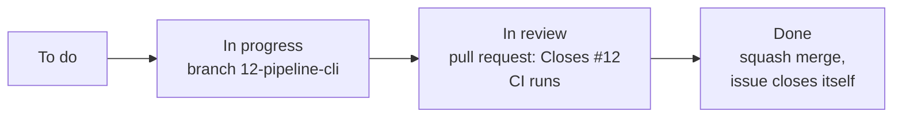

# Plan

> **Status:** **v1.1.** v1.0 approved 2026-11-05 by Vijay Bolle. Changes go through a pull request that updates this document.
> **Builds on:** [requirements](requirements.md), [design](design.md), [ADR-001](adr/001-model-choice.md), [ADR-002](adr/002-single-agent-with-stages.md), [ADR-003](adr/003-own-model-wrappers.md).

The design says **how** the agent is built. This plan says **in what order**: the work is cut into issues, grouped into milestones (one per release), and tracked on the project board. Every issue names the requirements it delivers, so nothing in the requirements is forgotten and nothing is built that isn't asked for.

---

## 1. Releases

Each release **works end to end**. Version numbers follow [Semantic Versioning](https://semver.org/): before 1.0, each `0.x` release adds features; `1.0.0` means every Must requirement is met.

| Milestone | What it delivers | Issues |
|---|---|---|
| **v0.1.0 First review in the terminal** | Give it a pull request link with `--dry-run` and it prints a review: understanding, findings for levels 1–3, and a recommendation. Nothing is posted | #1–#13 |
| **v0.2.0 Explores, double-checks and posts** | It explores related code on its own, double-checks findings, covers security and performance, and posts the review on GitHub | #14–#20 |
| **v0.3.0 Measured** | An offline evaluation set gives scores per review level, published in the README | #21–#23 |
| **v1.0.0 Complete** | Design-fit and quality checks, clean re-runs, the rules file, paid providers, the Python library on PyPI, and setup in five commands | #24–#29 |

**Why this order:** the first release goes through every stage in the simplest way, so the whole path works early and problems show up early. Later releases make each stage smarter. Measuring (v0.3) comes before the last features, so each one can be shown to help.

## 2. Issues

**Size:** S a few hours, M about a day, L several days. **Needs:** issues that must be finished first.

### v0.1.0 First review in the terminal

| # | Issue | Requirements | Done when | Needs | Size |
|---|---|---|---|---|---|
| 1 | **Project setup:** uv package, ruff, pytest with the 90% coverage gate, CI on Linux with pinned actions, pull request template with the self-review (3.2), `py.typed` marker, `.gitignore`, licence, README outline | NFR-2, NFR-6, NFR-8, FR-24 | `uv run pytest` and `uv run ruff check` pass locally and in CI; a new pull request shows the template | — | S |
| 2 | **Data types and interfaces** (`domain.py`): the types in design 2.1, the `GitHub` and `ChatModel` interfaces, `Deadline` | FR-9, NFR-8 | Every type exists with tests for its validation rules | 1 | S |
| 3 | **Settings** (`config.py`): `PRRA_` variables and `.env`, `GITHUB_TOKEN` fallback | NFR-7 | Defaults, overrides and the fallback are tested | 1 | S |
| 4 | **Secret masking** (`secrets.py`): known secret patterns, masked as `sk-...a1b2` | FR-21 | Every pattern in design section 8 is masked in tests; normal code is left alone | 1 | S |
| 5 | **Ollama wrapper and structured-output retry** (`models/`) | FR-9, FR-16, NFR-1 | Valid JSON comes back as the right type; one retry on bad output, then a clear error; "Ollama not running" and "model not downloaded" give fix-it messages. Tested with recorded replies | 2, 3 | M |
| 6 | **Read a pull request from GitHub** (`github/`): details, state, changed files, diffs with old and new line numbers, retries | FR-1, FR-16, FR-20 (state), NFR-10 | Closed and merged pull requests are refused, drafts are marked, missing ones give a clear message; 429 and 5xx are retried; diffs are parsed correctly. Tested with recorded GitHub replies | 2, 3 | M |
| 7 | **File selection** (`selection.py`): skips, ranking, batching, "too large" | FR-3, FR-4 | Lock, binary and generated files are skipped with a reason; ranking follows design section 6; every changed file ends up reviewed or listed as skipped | 2 | M |
| 8 | **Understand stage** and its prompt | FR-2 | Returns goal, summary, risky parts and the goal-unclear flag; tested with a fake model | 2, 5 | S |
| 9 | **Find pass A** (correctness and regressions, levels 1–3) and its prompt | FR-6, FR-9 | Findings have every field in design 2.1; batches are reviewed one by one; tested with a fake model | 2, 5, 7 | M |
| 10 | **Recommendation rules and sensitive areas** (`recommendation.py`, `sensitive.py`) | FR-12, requirements 5.3 | Every rule and every sensitive word has a test, including whole-word matching (`author.py` is not `auth`) | 2 | S |
| 11 | **Summary and comment text** (`summary.py`) | FR-14 | The Markdown matches the summary in the requirements, including skipped files and the reviewed commit; all text goes through masking | 2, 4 | S |
| 12 | **Pipeline, public function and command line:** stages in order, hard limit, failure rule, `review_pull_request()` (design 12.1), and `review <link> --dry-run` built on it, with exit codes | FR-15, FR-16, FR-24, NFR-3, NFR-4 | A dry run on a real public pull request prints a complete review; a failing stage gives "incomplete" and exit code 1; the command line only calls `review_pull_request()` | 5–11 | M |
| 13 | **Run log** (`runlog.py`) | FR-23 | Each run writes a JSON-lines file with every stage, model call and timing, masked | 4, 12 | S |

### v0.2.0 Explores, double-checks and posts

| # | Issue | Requirements | Done when | Needs | Size |
|---|---|---|---|---|---|
| 14 | **Repository snapshot:** tarball of the head commit (the fork's, for forks), safe unpacking | FR-19, FR-20 (forks), NFR-5 | Unpacking blocks paths that escape the folder; forks read the fork's code | 6 | S |
| 15 | **Project map and read-only tools** (`project_map.py`, `tools.py`) | FR-5, NFR-5 | Paths outside the snapshot and symbolic links are refused in tests; limits from design section 5 apply | 14 | M |
| 16 | **Explore stage** (the agent loop) | FR-5 | The model chooses tools step by step; the loop stops at `done`, the step limit or the time limit, and the summary says which | 8, 15 | M |
| 17 | **Find pass B** (security and performance, levels 4–5) | FR-6, FR-9 | As #9, for its own levels and categories | 9 | S |
| 18 | **Double-check stage and anchoring** (`anchoring.py`) | FR-10, FR-21 | Weak findings are dropped with a reason; every kept finding sits on a changed line; secrets are never quoted | 4, 9 | M |
| 19 | **Publish:** head-commit check, one "comment" review with all findings, summary comment | FR-12, FR-13, FR-14, FR-19 | Nothing is posted if the commit changed; never sends approve or request-changes; tested with a fake GitHub, then checked by hand on a test repository | 6, 11 | M |
| 20 | **Preflight and lock:** token permissions, model reachable, one run per pull request | FR-16, FR-20 (lock) | Each setup problem gives its fix-it message; a second run on the same pull request is refused; an old lock from a crash is replaced | 5, 6, 12 | S |

### v0.3.0 Measured

| # | Issue | Requirements | Done when | Needs | Size |
|---|---|---|---|---|---|
| 21 | **Evaluation harness** (`evaluation/`): case folders, `FixtureGitHub`, scorer, report, 3 runs | FR-18, requirements 7.1 | `pr-review-agent eval eval/cases` runs offline and writes a report per level and a review sheet | 12, 19 | M |
| 22 | **Evaluation cases:** at least 5 planted problems per level 1–5 (the design-fit and quality ones come with #24), at least 5 clean, at least 3 prompt-injection; a third held out | FR-18, requirements 7.1 | Cases exist and each was checked by hand to contain exactly the planted problem | 21 | L |
| 23 | **First full evaluation:** run it, record scores and timings in the README, confirm the 16k context and the speed targets | FR-18, NFR-3 | Results are published, compared with the targets in requirements 7, and any gap becomes a new issue | 22 | S |

### v1.0.0 Complete

| # | Issue | Requirements | Done when | Needs | Size |
|---|---|---|---|---|---|
| 24 | **Find pass C** (design fit and code quality) plus at least 3 design-fit and 3 quality evaluation cases | FR-7, FR-8, FR-18 | Each finding names the existing code it should match; evaluation scores recorded | 16, 22 | L |
| 25 | **Clean re-runs:** fingerprints, skip resolved threads, update the one summary | FR-11, FR-22 | A second run on an unchanged pull request posts no duplicates and edits its summary | 19 | M |
| 26 | **Project rules file,** read from the base branch | FR-17 | Ignore patterns, extra sensitive areas and instructions work; a change to the rules file in the pull request is ignored and mentioned | 7, 10 | S |
| 27 | **Paid providers:** OpenAI-compatible and Anthropic wrappers | NFR-1, NFR-7, ADR-003 | Switching provider is a settings change only; tested with recorded replies; one real call checked by hand | 5 | M |
| 29 | **Python library:** public API reference and examples, the PyPI package name, publishing to PyPI from CI | FR-24 | Every public name is documented with an example; a test fails if the public API changes without a version bump; `pip install` from PyPI works on Windows and Linux | 12 | M |
| 28 | **Release v1.0.0:** setup in five commands, README with diagrams and scores, final evaluation, changelog | NFR-9, FR-18 | A fresh clone reaches its first review in five commands or fewer, following only the README | 23–27, 29 | M |

Every FR and NFR appears in at least one row above. NFR-5 (safe tools and network) is spread across #6, #14, #15 and #18.

## 3. Quality rule

Every change is checked for **gaps, integration and code quality**, and tested at three levels, so that problems are found when the change is made, not at the end of the project.

### 3.1 Three levels of tests

| Level | What it proves | How | When |
|---|---|---|---|
| **1. Unit tests** | Each function and module works alone, including edge cases and failure paths (bad input, errors, limits) | `pytest` with fakes: no real model, network or GitHub | Every pull request, in CI |
| **2. Integration tests** | The parts work **together**: the real pipeline runs a whole review, from link to result, with `FakeChatModel` and `FakeGitHub` | `pytest`, in `tests/integration/` | Every pull request, in CI. Each issue that adds or changes a stage adds or updates one |
| **3. Real run** | It works for real: the real local model on a real test pull request | By hand, with the output pasted into the pull request | Every issue that changes what the user sees, and at the end of every milestone |

**Coverage gate:** CI fails if test coverage drops below **90%**. The plain-code rule modules (`selection`, `sensitive`, `recommendation`, `secrets`, `anchoring`, `fingerprints`) aim for 100%, because the trust in the agent's output rests on them.

### 3.2 Self-review before every pull request

Written in the pull request description (the template asks for it):

1. **Gaps:** compare the work with the issue's "Done when", its requirements and the design. Anything missing or different is fixed now or recorded as a new issue, never silently dropped.
2. **Integration:** is the new part wired in (`factory.py`, `pipeline.py`, settings, command line)? Do the integration tests still pass? Does everything that uses the changed code still work?
3. **Code quality:** `ruff` clean, no repeated code, small functions, clear names, comments that explain why, helpful error messages, no leftover debug code.

### 3.3 Definition of done

- [ ] The "Done when" in the issue is met.
- [ ] Unit tests cover the new behaviour, including edge cases and failures.
- [ ] Integration tests updated if a stage or its wiring changed.
- [ ] Real run done and pasted, if the user-visible behaviour changed.
- [ ] `ruff`, `pytest` and the coverage gate pass, locally and in CI.
- [ ] Self-review (3.2) written in the pull request.
- [ ] Docs updated if behaviour changed.
- [ ] Merged through a pull request that says `Closes #N`.

### 3.4 Milestone review

Before a release is tagged: re-read every requirement in the milestone, run the full test suite, do a real run, and list any gap. The release is tagged only when the list is empty or every gap has its own issue in a later milestone.

## 4. Workflow

1. **Agree the approach:** before coding, the issue gets a short comment saying what will be built, how it fits the design, and what result to expect.
2. Move the issue to **In progress** and create a branch named after it, for example `12-pipeline-cli`.
3. Write the code and the tests (3.1), in small commits.
4. Open a pull request whose description says `Closes #12`, summarises each changed file, and contains the self-review (3.2) and the ticked definition of done (3.3).
5. CI must pass, and the maintainer reviews and approves the change.
6. **Squash merge** into `main`: the pull request becomes one commit, the issue closes itself, and the card moves to **Done**.

**`main` is protected:** changes reach it only through a pull request with passing CI.

**Releasing:** when a milestone's issues are all done, do the milestone review (3.4), update `CHANGELOG.md`, tag the commit (`v0.1.0`) and publish a GitHub release with the notes.

## 5. Labels

| Group | Labels |
|---|---|
| Kind | `setup`, `feature`, `eval`, `docs`, `bug` |
| Area | `github`, `model`, `pipeline`, `rules` |
| Priority (from the requirements) | `must`, `should`, `could` |
| Size | `size: S`, `size: M`, `size: L` |

## 6. Change history

| Version | Date | Change |
|---|---|---|
| v0.1 | 2026-11-05 | First draft |
| v1.0 | 2026-11-05 | Quality rule added (section 3: three test levels, self-review, coverage gate, milestone review); approved by Vijay Bolle |
| v1.1 | 2026-11-05 | FR-24 (Python library): `py.typed` in #1, public function in #12, new issue #29 |
